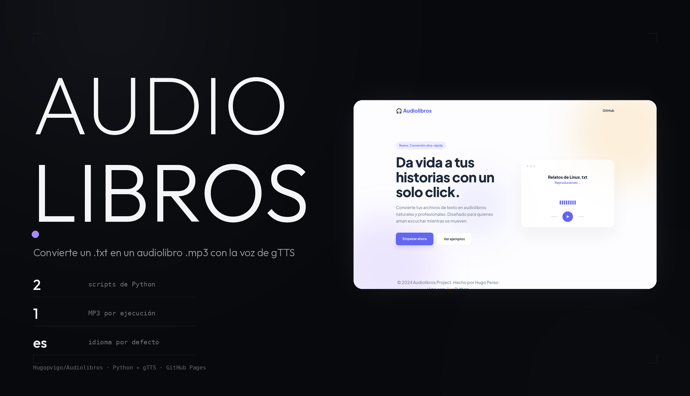
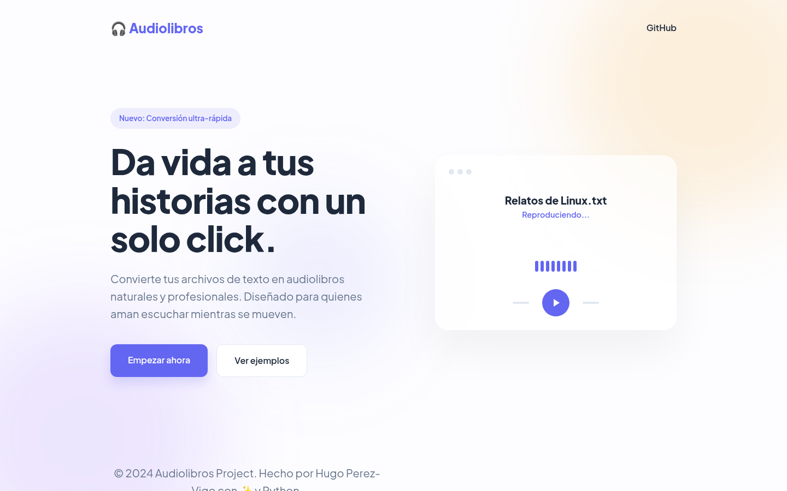

<meta property="og:title" content="AUDIOLIBROS">
<meta property="og:description" content="Un script de Python que convierte un archivo de texto en un audiolibro MP3.">
<meta property="og:image" content="https://raw.githubusercontent.com/Hugopvigo/Audiolibros/main/docs/capturas/og.png">

<p align="center">
  
</p>

<p align="center">
  <b>Un script de Python que convierte un archivo de texto en un audiolibro MP3.</b><br>
  Usa la voz de Google Text-to-Speech (gTTS); la conversión ocurre en la terminal.
</p>

<p align="center">
  <a href="https://hugopvigo.github.io/Audiolibros/"></a>
  
  
  
</p>

---

## Qué es esto

Dos scripts de Python y una portada estática:

- **`audiolibro.py`** — lee un `.txt` y guarda el resultado como `.mp3` con la
  voz de Google Text-to-Speech. Acepta fichero de entrada, fichero de salida e
  idioma por línea de órdenes.
- **`idiomas.py`** — lista las voces instaladas en el sistema con `pyttsx3`, el
  motor offline, para cuando no quieres depender de internet.
- **`index.html`** — la portada del proyecto, publicada en GitHub Pages. Es una
  página de presentación: la conversión se hace en el script de Python, no en
  el navegador.


*La portada publicada en GitHub Pages.*

## Cómo se usa

Necesitas Python 3 y la librería `gTTS`:

```bash
pip install gTTS
```

Con los ficheros de ejemplo que trae el repo:

```bash
python3 audiolibro.py                    # test.txt → test.mp3
```

Con tus propios ficheros y otro idioma:

```bash
python3 audiolibro.py mi_libro.txt mi_audio.mp3
python3 audiolibro.py libro_en.txt audio_en.mp3 --lang en
```

El script comprueba que el fichero exista y no esté vacío, y avisa por pantalla
del resultado:

```
OK: Audiolibro guardado como mi_audio.mp3 (idioma: es)
KO: Error: El archivo mi_libro.txt no se encontró.
```

### El motor offline

`idiomas.py` no convierte: solo lista las voces que `pyttsx3` encuentra en
tu máquina.

```bash
pip install pyttsx3
python3 idiomas.py
```

```
--- Voces detectadas: 75 ---
ID: spanish
Nombre: spanish
Idiomas: ['es']
------------------------------
ID: spanish-latin-am
Nombre: spanish-latin-am
Idiomas: ['es-la']
```

El número de voces depende de las instaladas en el sistema.

## Estructura

```
audiolibros/
├── audiolibro.py      conversión .txt → .mp3 con gTTS
├── idiomas.py         lista de voces locales con pyttsx3
├── index.html         portada estática
├── style.css
├── script.js          animaciones de la portada (visualizador y parallax)
├── test.txt           texto de ejemplo
├── test.mp3           audio generado a partir de test.txt
└── docs/capturas/     capturas del README
```

## Licencia

El código está bajo **CC BY-NC-SA 4.0** (compartir con atribución, sin uso
comercial y en las mismas condiciones). Ver [LICENSE](LICENSE).

Los archivos de audio que generes son tuyos: no tienen ninguna licencia
adicional.
